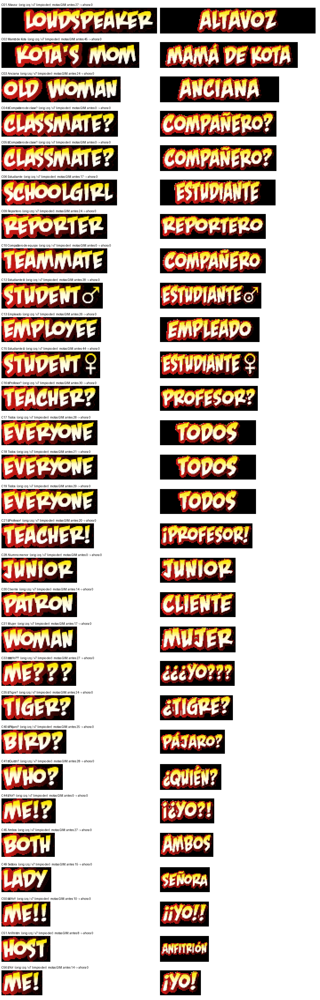
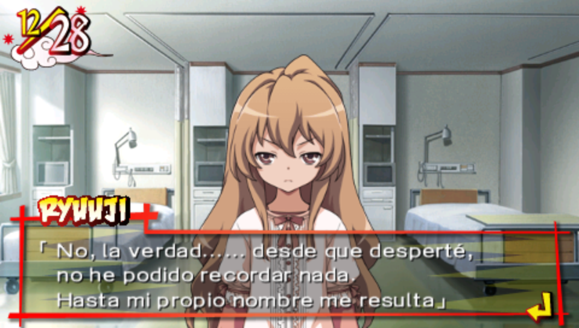
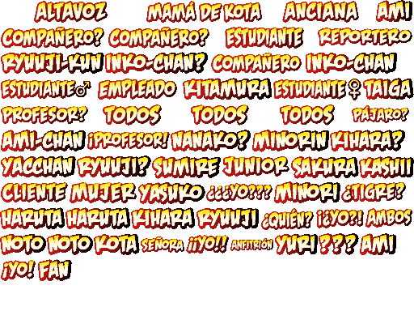

# Toradora! Portable — Traducción al español (v7)

Parche de traducción al español neutro de **Toradora! Portable** (PSP, 2009), la novela visual de Toradora! que solo salió en Japón. Este proyecto traduce el juego completo al español a partir del parche inglés v1.10.

> **Solo se distribuye el parche. Nunca se distribuye la ISO del juego.** Necesitas tu propia copia legal de la ISO en inglés del parche v1.10 para aplicar este parche.

## Qué traduce la v7

- **Diálogo completo:** 310 de 311 escenas con texto (27.466 cadenas, ~183.000 palabras), más las 1.359 cadenas del sistema (`STARTPOINT`).
- **Texto del sistema:** menú de título, menús, opciones, guardado/carga, mensajes — todo en español.
- **Listas:** objetos, nombres de personajes y lugares.
- **Títulos de escena:** los 275 títulos únicos, en español.
- **Texturas:** el atlas de nombres de los personajes (p. ej. `EVERYONE` → `TODOS`) y los 13 encabezados del menú del sistema (`MENÚ DEL SISTEMA`, `GUARDAR`, `CARGAR`…), redibujados celda por celda.

La documentación completa del proceso —metodología, herramientas, historial de versiones y todos los problemas encontrados con sus soluciones— está en `docs/documentacion-proceso.pdf` (26 páginas, en español).



## Cómo aplicar el parche

**ISO de origen (requerida):** `toradora-portable-en-v1.10.iso` (parche inglés v1.10), 1.708.947.456 bytes, MD5 `24bac0ccfd6b293f585804eab86d82c2`. Si tu ISO no tiene ese MD5, el parche puede fallar. Verifica el MD5 antes de aplicarlo.

**Interfaz gráfica (Windows):**

1. Descarga e instala xdelta UI (o Delta Patcher), gratuitos.
2. En "Patch file" / "Parche": selecciona `parche/toradora-portable-ES-v7.xdelta`.
3. En "Source file" / "Archivo original": selecciona tu ISO en inglés.
4. En "Output file" / "Archivo de salida": elige un nombre nuevo, por ejemplo `toradora-portable-ES-v7.iso`.
5. Pulsa "Apply patch" / "Aplicar parche" y espera a que termine.

**Línea de comandos** (necesitas xdelta3 instalado: Linux `sudo apt-get install xdelta3`; Windows, descarga el binario; macOS `brew install xdelta`):

```bash
xdelta3 -d -s toradora-portable-en-v1.10.iso \
        parche/toradora-portable-ES-v7.xdelta \
        toradora-portable-ES-v7.iso
```

**Verificación (obligatoria).** La ISO resultante DEBE tener este MD5 exacto:

```
62a5416791fbe20e8896320a830bb90f
```

Si el MD5 no coincide, NO uses esa ISO: borra el archivo generado y repite el proceso con una ISO de origen correcta. Para comprobar el MD5: Windows (PowerShell) `Get-FileHash toradora-portable-ES-v7.iso -Algorithm MD5`; Linux / macOS `md5sum toradora-portable-ES-v7.iso`.

**Cómo jugar:** compatible con PPSSPP (PC, Android, iOS) y con PSP real (con custom firmware). Nota: en PPSSPP para iOS, en el primer arranque, si el juego se cierra tras el aviso del Memory Stick, cambia en Ajustes → Sistema → "Método de sincronización de E/S" a "Simular retraso del UMD"; una vez que arranque bien, puedes volver a "Rápido".





## Contenido de este repositorio

```
├── README.md                     Este archivo
├── parche/
│   ├── toradora-portable-ES-v7.xdelta   Parche xdelta3 (ES v7)
│   └── LEEME.txt                 Instrucciones para aplicar el parche
├── docs/
│   ├── documentacion-proceso.pdf Documentación completa del proceso (26 págs.)
│   └── documentacion-proceso.md  Misma documentación, en Markdown
├── traduccion/
│   ├── po-es/                    Fuentes de traducción: 310 escenas + STARTPOINT.po
│   └── text-es/                  Listas traducidas (objetos, personajes, lugares)
├── datos/
│   └── titulos-es.json           Tabla de los 275 títulos de escena EN → ES
├── scripts/
│   ├── build-final-v7.py         Construye la ISO v7 (a partir de la ISO EN v1.10)
│   ├── verificar-v7.py           Verificación binaria de la ISO v7
│   ├── gim_codec.py              Codec GIM (texturas PSP) usado en el proyecto
│   ├── recalcular_guiones.py    Recalcula los saltos de línea ＿ (≤40 car., ≤3 líneas)
│   └── verificar-desplazados-rondas1-3.py  Verificación de correcciones aplicadas
├── informes/
│   ├── reporte-titulos-escena.md    Censo y traducción de los 275 títulos
│   ├── reporte-v7-final.md          Construcción y verificación de la v7
│   ├── comparacion-celdas-v7-limpio.md  Comparación por celda del atlas
│   └── reporte-acortes-11-escenas.md    Acortamientos mínimos de las 11 escenas
└── imagenes/
    ├── comparacion-celdas-v7-limpio.png  Comparación por celda (original / v7)
    ├── t10.png                   Plaquita RYUUJI en juego (PPSSPP)
    └── sg_chaname-v7-limpio-decoded.png  Atlas de nombres v7 decodificado
```

## Estado del proyecto

Versión v7 (noviembre de 2026). La traducción está completa y probada en juego (PPSSPP en VM y en iPhone). Quedan documentadas como pendientes menores: la pantalla de Cargar no se verificó directamente en la VM, y la tabla completa de los 275 títulos vive en `datos/titulos-es.json` (la documentación incluye solo los 40 títulos acortados).

## English summary

This is a Spanish translation patch (v7) for Toradora! Portable (PSP). It translates the full dialogue (310 scenes), system text, lists, all 275 scene titles, and the speaker-name atlas and system-menu headers. Apply `parche/toradora-portable-ES-v7.xdelta` to your own copy of the English v1.10 patched ISO (`toradora-portable-en-v1.10.iso`, MD5 `24bac0ccfd6b293f585804eab86d82c2`) using xdelta3:

```bash
xdelta3 -d -s toradora-portable-en-v1.10.iso \
        parche/toradora-portable-ES-v7.xdelta \
        toradora-portable-ES-v7.iso
```

The resulting ISO must have MD5 exactly `62a5416791fbe20e8896320a830bb90f`. Only the patch is distributed here — never the game ISO. Full documentation (in Spanish) is in `docs/documentacion-proceso.pdf`.

## Créditos

Traducción al español, coordinación y control de calidad: **@Sam-Bks**, con ayuda de **Muse (Bodoque)**.

Toradora! Portable es © Guyzware / Bandai Namco. Este es un proyecto no oficial, sin ánimo de lucro, hecho por fans para fans. Este parche parte de la ISO con el parche en inglés v1.10 ya aplicado.
